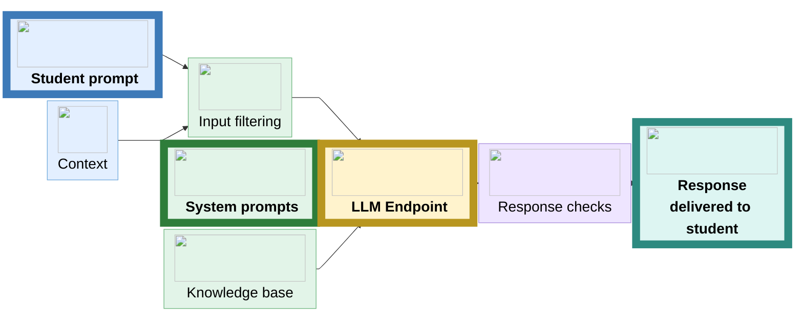
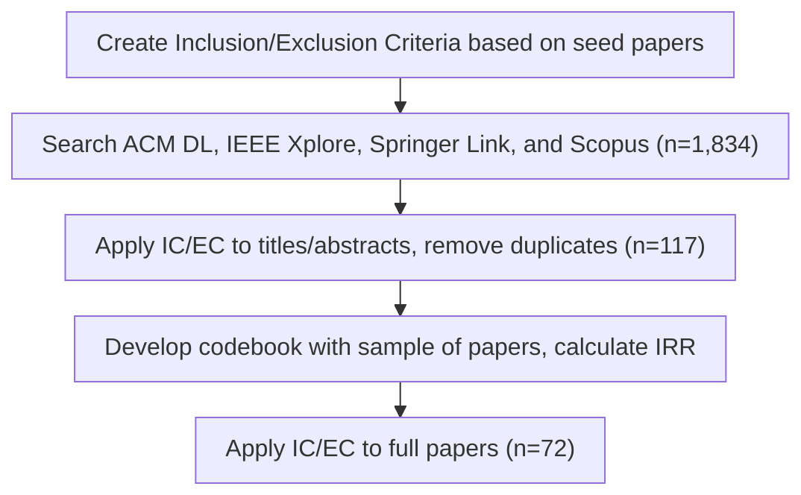

# GenAI-Powered Postsecondary Computer Science Education Tools
## A Systematic Literature Review

  

    
<strong>Owen Sizemore</strong>

    

      

        
      

      

        
      

    

  

  

    
Seth Bernstein

    

      

        
      

      

        
      

    

  

  

    
Audrey Ostrom

    

      

        
      

      

        
      

    

  

  

    
Thomas Rexin

    

      

        
      

      

        
      

    

  

  

    
Kristin Stephens-Martinez

    

      

        
      

      

        
      

    

  

<!--
Hello all! My name is Owen Sizemore, and I am a second-year Computer Science PhD student at Duke University. It is an immense privilege to be able to present our work here at Koli, and an even greater privilege to be the first presenter of the conference. 

This work is a collaboration with other PhD students across the United States, and I'm very excited to share with you our findings on GenAI-powered Postsecondary Computer Science Education tools. 

Before I get into the weeds of the scope of our paper, though, I want to contextualize why we felt this topic was important and our strategy for conducting our literature review. Our work is part of a larger question that many CS educators and researchers have been grappling with over the past couple of years, which is...
-->
---

# How do we regulate GenAI use in postsecondary CSEd?

<SpectrumArrow />

<!--
I don't need to remind you all of the challenges that have been presented by the proliferation of GenAI in postsecondary CS classrooms, which span concerns about overreliance, impacts on critical thinking and problem-solving skills, and ensuring that students are prepared for advanced work and careers in computer science.

What I do want to discuss though is how we categorize strategies from instructors to address these challenges. We can think of it as a spectrum where on one side we are encouraging less AI use and on the other more AI use. Some responses by instructors have been very heavy-handed, such as by attempting to ban the use of GenAI in classrooms entirely, or allowing unbridled use without any restrictions or guardrails. 

Both of these approaches come with risks, so we want to consider a more nuanced set of strategies where we are guiding students toward responsible AI use, acknowledging that students have access to tools like ChatGPT and Claude but also encouraging them to use the tools in a way that supports their learning.
-->
---

# What does this look like?
- Course interventions to learn new skills (prompting, evaluating GenAI output, etc.) 
- Assignments demonstrating the strengths/weaknesses of GenAI
- Student reflections to encourage thoughtful GenAI use
- Custom tools with guardrails to scaffold learning and mitigate irresponsible GenAI use

<!--
So what are some examples of strategies to support responsible AI use? There are many approaches

We wanted to explore one specific approach, which is the use of custom tools that offer an alternative to commercial tools like ChatGPT. I have a software engineering background, and I was particularly interested in what motivated educators to build custom tools and how they distinguished themselves from commercial tools.
-->
---
class: tool-flow-slide
---

<h1 class="tool-flow-title">Tool Flow</h1>

<!--
Within our literature review we observed a wide range of tool designs and architectures, but the most common was a text-based interface similar to ChatGPT or Claude, but with some additional components and guardrails added on the back end.

The blocks with bold text and a thicker outline are core components that were found in most tools, while the other blocks were components that were sometimes added for additional functionality.

Begins with student prompt, might be additional context as well. Inputs could be filtered to avoid off-topic responses, and the sanitized input is combined with system prompts and a knowledge base and fed to the LLM endpoint, such as the OpenAI API. From there, a response was returned from the endpoint, which could be checked to ensure it addresses the students' query, and then delivered back to the student on the frontend.
-->
---
autoClicks: false
---

# Research Questions
1. **RQ1**: What approaches are currently used to build GenAI-powered postsecondary CSEd tools, and how are they motivated?
2. **RQ2**: What educational theories and framings inform the development of GenAI-powered postsecondary CSEd tools?
3. **RQ3**: What methods are used to empirically evaluate the effects of GenAI-powered postsecondary CSEd tools?

<!--
To better understand GenAI-powered postsecondary CSEd tools, we asked the following research questions:
-->
---

## Literature Review Methodology 

(Kitchenham & Charters, PRISMA)

<!--
To structure our literature review, we followed the practices outlined by Kitchenham and Charters as well as the PRISMA 2020 guidelines.

The full details can be found in the paper itself, but I'll summarize with two key points. The first was that we started with just over 1,800 search results from various digital libraries, and finished with 72 papers that we fully analyzed. The second is that we scoped our literature review to focus specifically on postsecondary CSEd (no K-12), tools that used modern LLMs (not older ITSes and things like that), and the tools had to be student-facing, so no autograders or instructor tools
-->
---

## Codebook Categories

  

    RQ1
    <h3>Problem Space</h3>
    
Why is the tool being built?

  

  

    RQ1
    <h3>Pedagogical Features</h3>
    
How does the tool support learning?

  

  

    RQ1
    <h3>Delivery Method</h3>
    
How do students access the tool?

  

  

    RQ2
    <h3>Educational Framings</h3>
    
What research is the tool based on?

  

  

    RQ3
    <h3>Evaluation Goals</h3>
    
What do the authors want to understand about the tool?

  

  

    RQ3
    <h3>Evaluation Methods</h3>
    
How are the tools empirically evaluated?

  

<!--
We divided our codebook into 6 categories. Codes within categories were not mutually exclusive; for example, we coded for 8 different pedagogical features, and a tool could theoretically have all 8 or none of them

The top 3 addressed RQ1, educational framings addresses RQ2, and the last two address RQ3
-->

---
autoClicks: false
---

# Motivations for building tools (RQ1)

- Desire to provide personalized, context-aware support to students
- Concern that unrestricted GenAI use can lead to overreliance
- Lack of scalable help-seeking in CS classrooms

<!--
Two most commonly identified motivations were desire to provide personalized support and concern that LLMs lead to overreliance

These two themes overlap with each other, as ChatGPT and other tools can offer that personalized support, but doesn't always do so in a way that supports learning. Further, we observed instructors desiring a tool whose responses are tailored to their specific course context, based on concerns that commercial tools don't know what prior knowledge a student has and what they're learning in class

We also observed some instructors responding to high enrollment intro-sequence CS courses. There was an acknowledgement that the limited number of course staff can't provide 1 on 1 support to everyone, so providing that support in an automated way through a GenAI-powered tool was a promising alternative
-->
---
autoClicks: false
---

# Tool features and approaches (RQ1)

**Features**

- Scaffold feedback so the tool doesn’t give away answers
- Adapt feedback to students’ prior interactions
- Ground responses in curated learning material

**Delivery method**
- Majority of tools delivered via a standalone web app, others embedded in course platforms or packaged as IDE extensions

<!--
You're going to be hearing the term scaffolding a lot here, but this concept is very much present in how the tools function. 
Scaffolding presents itself in different ways: system prompts telling the LLM to structure its response to not give answers, post-response checks to make sure the output doesn't include lines of code, etc.

Adaptive feedback relates to this idea and is similar to how students interact with commercial tools: sometimes explicit (student makes specific request and LLM adjusts to it), other times implicit (tool holds on to conversation history and that informs future interactions)

Third bullet refers to the use of RAG or databases to provide richer context to the tool. One example: text transcriptions of lectures given to LLM along with instructions to reference the lectures when delivering responses. Helps the tool's responses stay relevant to the student and the course

With delivery method, most often saw tools being accessed from standalone websites just like ChatGPT or Claude, but a few of them embedded int a course forum or LMS and fewer still were integrated closely into a coding environment through IDE extension or command-line tool

81% scaff
57% adapt
25% RAG-data
63% standalone web app
-->
---
autoClicks: false
---

# Educational Framings (RQ2)

- Most frequent mentions: Scaffolding, Cognitive Load Theory, metacognition, Self-regulated learning
  - High co-occurrence between all these
- No clear trend for when or how framings were used
  - Median of 3 framings mentioned
  - Some papers did not include any coded framings, but still built on prior work
- Still need to understand connections between cited research and tool features

<!--
Potentially split this into 2 slides
Remove percentages here, but scaffolding still useful
"Disproved" is technically not true, should remove this bullet

We looked for mentions of 13 different terms pertaining to the literature in CSEd - scaffolding, self-efficacy, self-regulated learning, etc.

Four framings we observed most often, and I'm using the term "framing" because these terms weren't always qualified with citations - hard to pin down something like "scaffolding", which is very broad

We didn't identify any overarching trends about when or how these framings were used, but generally the use of them was quite diverse. We came in with a slightly cynical assumption that papers wouldn't have thorough framings

Papers with lots of buzzwords and references are more likely to be published

scaff 63%
clt 36%
meta 36%
SRL 23%
-->
---
autoClicks: false
---

# Evaluation Goals (RQ3)

- Understand student perceptions
- Understand student usage patterns
- Measure impact on learning outcomes
  - Many examples: 
    - Post-intervention test performance
    - Changes between pre- and post-test scores
    - Measurements of students' affective state (self-efficacy, nervousness, etc.)

<!--
Good number of papers had more than one goal

Sometimes depended on maturity of the tool: pilot stage (understand what students think) vs. longer-term analysis (will this help students learn CS)
-->

---
autoClicks: false
---

# Evaluation Methods (RQ3)

- Post-surveys and logging usage data both common and frequently done together (also relatively easy to perform)
- 38% of papers that included post-surveys also included pre-surveys
  - Less emphasis on measuring changes, just want to understand how students felt about the tool
- Multiple evaluation methods were common
  - 69% of papers used between 2 and 4 methods
  - Just 2 papers had no evaluations at all

<!--
Interesting to consider low-hanging fruit on part of researchers
-->
---

# Recommendations

  

    <ph-question class="rec-icon" />
    <h3>Start with the problem, not the tool</h3>
  

  

    <ph-lego class="rec-icon" />
    <h3>Build on what the field already knows</h3>
  

  

    <ph-magnifying-glass class="rec-icon" />
    <h3>Investigate the gaps</h3>
  

  

    <ph-arrows-split class="rec-icon" />
    <h3>Consider that students have alternatives</h3>
  

<!--
Start with the problem, not the tool
- Resist the urge to build a solution that doesn’t address a specific problem 
- Don't integrate GenAI tools into your course without a meaningful justification 
- Apply principles from learner-centered design, HCI, & needsfinding

Build on what the field already knows
- Understand what other tools have gotten right and wrong already
- Meet the minimum standards for a quality custom tool (prompt engineering, filtering out bad responses, minimizing hallucinations, etc.)
- Make meaningful connections to prior research in CSEd, learning science, cognitive science, and other fields

Investigate the gaps
- This SLR suggests a skew toward introductory programming
- Tools with lots of scaffolding might be great for a CS1/CS2 environment, but unclear how this would fare with other students
- Expand the scope of tools to include more students and more competencies (software engineering, system design, AI-assisted programming, etc.)

Consider that students have alternatives
- "If you build it, they will come" doesn’t apply to a student with plenty of GenAI tools to choose from
- Students will always have access to commercial tools in unsupervised settings
- Make thoughtful design decisions to give students a good reason to use your tool
  - Use RAG/databases to leverage course content
  - Embed tools in existing course platforms
  - Make regular improvements in response to feedback
-->
---
layout: two-cols-header
autoClicks: false
---

# Summary

::left::

- GenAI-powered postsecondary CSEd tools are one of many strategies to regulate GenAI use
- Tools integrate pedagogical features to promote learning and limit the pitfalls of commercial GenAI
- Tools are contextualized by a wide range of educational framings and many evaluation strategies
- Consider the problem at hand, prior research, and student alternatives when making the decision to develop a tool

::right::

  
GenAI-Powered Postsecondary Computer Science Education Tools: A Systematic Literature Review

  
QR code

  
<a href="mailto:owen.sizemore@duke.edu">owen.sizemore@duke.edu</a>

---

# Start with the problem, not the tool

- Resist the urge to build a solution that doesn’t address a specific problem
- Don't integrate GenAI tools into your course without a meaningful justification
- Apply principles from learner-centered design, HCI, & needsfinding

---

# Build on what the field already knows

- Understand what other tools have gotten right and wrong already
- Meet the minimum standards for a quality custom tool (prompt engineering, filtering out bad responses, minimizing hallucinations, etc.)
- Make meaningful connections to prior research in CSEd, learning science, cognitive science, and other fields

---

# Investigate the gaps

- This SLR suggests a skew toward introductory programming
- Tools with lots of scaffolding might be great for a CS1/CS2 environment, but unclear how this would fare with other students
- Expand the scope of tools to include more students and more competencies (software engineering, system design, AI-assisted programming, etc.)

---

# Consider that students have alternatives

- "If you build it, they will come" doesn’t apply to a student with plenty of GenAI tools to choose from
- Students will always have access to commercial tools in unsupervised settings
- Make thoughtful design decisions to give students a good reason to use your tool
    - Use RAG/databases to leverage course content
    - Embed tools in existing course platforms
    - Make regular improvements in response to feedback

---

# Other Trends

- Model choice reasoning remains unclear
    - Most used OpenAI models, but future tools will need to consider institutional compliance and data privacy
- Tools predominantly targeted introductory CS students
- Control groups were seldom used in evaluations

<!--
Backup slide
-->
---
