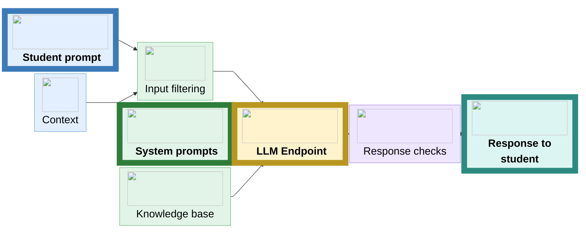
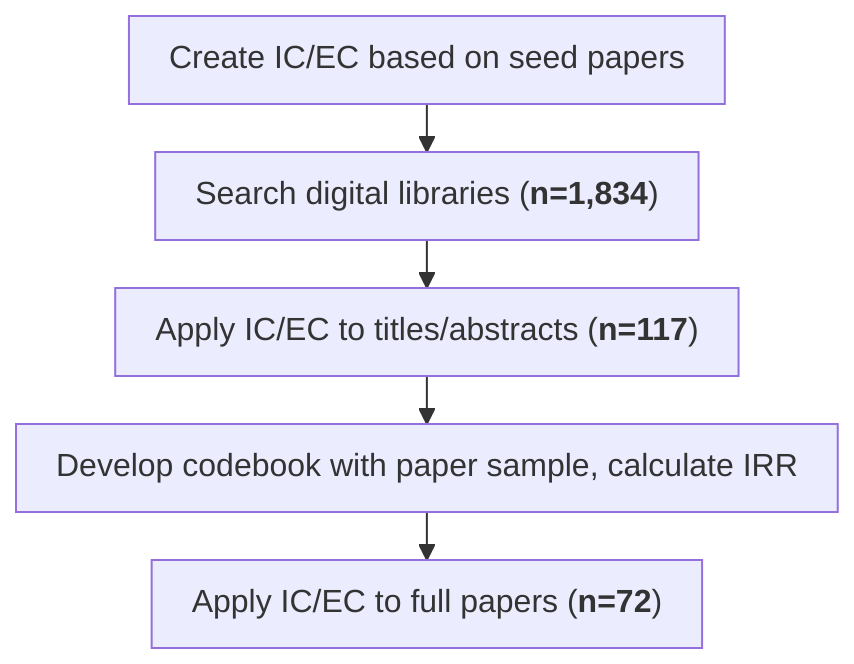

# GenAI-Powered Postsecondary Computer Science Education Tools
## A Systematic Literature Review

  

    
<strong>Owen Sizemore</strong>

    

      

        
      

      

        
      

    

  

  

    
Seth Bernstein

    

      

        
      

      

        
      

    

  

  

    
Audrey Ostrom

    

      

        
      

      

        
      

    

  

  

    
Thomas Rexin

    

      

        
      

      

        
      

    

  

  

    
Kristin Stephens-Martinez

    

      

        
      

      

        
      

    

  

<!--
(30 seconds)

Alright, let's get started

Such a privilege to present for the first time at Koli, and be the first presenter

Owen Sizemore, CS PhD student at Duke

A little nice to go first because I get to talk about AI and GenAI before people get sick of hearing about it

Before we started working on this lit review, we were curious about the question
-->

---

# How do we regulate GenAI use in postsecondary CSEd?

<SpectrumArrow />

<!--
SCRIPT: shorten script if needed, could make my point in 30 seconds

Question comes with a lot of challenges

Consensus that GenAI can be harmful to students, less consensus on what to do about it

Spectrum of perspectives

Want to consider a middle ground where we acknowledge that these tools are out there but we want to guide students to use them in ways that support their learning
-->

---

# What does this look like?
- Course interventions to learn how to use GenAI
- Student reflections to encourage thoughtful GenAI use
- Custom tools with guardrails to mitigate irresponsible GenAI use

<!--
Lots of existing instructional strategies in the research:
- Course interventions to learn new skills (prompting, evaluating GenAI output, etc.) 
- Student reflections to encourage thoughtful GenAI use
- Custom tools with guardrails to scaffold learning and mitigate irresponsible GenAI use
-->

---
layout: center
---

---
class: tool-flow-slide
---

<h1 class="tool-flow-title">Tool Paradigms</h1>

<!--
At their core, tools behave like commercial ones, but with additional guardrails

Patterns we observed across most/all tools are in bold

Take an input from the student, apply some prompting to constrain the output, feed it to an LLM, give the response to students
-->

---
autoClicks: false
---

# Research Questions
1. <strong>RQ1 (Approaches & motivations)</strong>: What approaches are currently used to build GenAI-powered postsecondary CSEd tools, and how are they motivated?
2. <strong>RQ2 (Educational framings)</strong>: What educational theories and framings inform the development of GenAI-powered postsecondary CSEd tools?
3. <strong>RQ3 (Evaluations)</strong>: What methods are used to empirically evaluate the effects of GenAI-powered postsecondary CSEd tools?

<!--
Motivated by three research questions regarding papers about tools
-->

---

## Literature Review Methodology 

(Kitchenham & Charters, PRISMA)

<!--
Followed best practices from Kitchenham & Charters & PRISMA

Started with 1,800 papers, ended with 72 that we fully analyzed and coded
-->

---

## Codebook Categories

  

    RQ1
    <h3>Problem Space</h3>
    
Why is the tool being built?

  

  

    RQ1
    <h3>Pedagogical Features</h3>
    
How does the tool support learning?

  

  

    RQ1
    <h3>Delivery Method</h3>
    
How do students access the tool?

  

  

    RQ2
    <h3>Educational Framings</h3>
    
What research is the tool based on?

  

  

    RQ3
    <h3>Evaluation Goals</h3>
    
What do the authors want to understand about the tool?

  

  

    RQ3
    <h3>Evaluation Methods</h3>
    
How are the tools empirically evaluated?

  

<!--
We divided our codebook into 6 categories

Codes within categories were not mutually exclusive; for example, we coded for 8 different pedagogical features, and a tool could theoretically have all 8 or none of them

The top 3 addressed RQ1, educational framings addresses RQ2, and the last two address RQ3
-->

---
autoClicks: false
---

# Motivations for building tools (RQ1)

- Provide personalized, context-aware support
- Unrestricted GenAI use can lead to overreliance
- Lack of scalable help-seeking in classrooms

<!--
Instructors want the benefits of ChatGPT's natural language capabilities (personalization, ability to recognize a student's context), but see risks if guardrails aren't put in place

Some instructors are also concerned about scaling their support to large CS enrollments
-->

---
autoClicks: false
---

# Tool features and approaches (RQ1)

**Features**

- Scaffold feedback so the tool doesn’t give away answers
- Curated practice/problem sets
- Ground responses in curated learning material

**Delivery method**
- Mostly standalone web apps

<!--
Scaffolded feedback: system prompts, input pre-processing, output post-processing

Curated practice/problem sets so the students are using the tools in a more structured/guided way

Using RAG/connected database that the LLM can reference when responding to students

81% scaff
57% adapt
25% RAG-data
63% standalone web app
-->

---
autoClicks: false
---

# Educational Framings (RQ2)

- Most frequent mentions:
  - Scaffolding
  - Cognitive Load Theory
  - Metacognition
  - Self-regulated learning
- Connection between framings and tool features still unclear

<!--
Coded for both formal theories and informal terms/buzzwords

4 most common terms that frequently appeared together

Wasn't always clear how a paper's use of educational terminology informed features; some papers made strong connections, others didn't

scaff 63%
clt 36%
meta 36%
SRL 23%

- Most frequent mentions:
    - Scaffolding
    - Cognitive Load Theory
    - Metacognition
    - Self-regulated learning
  - High co-occurrence between all these
- No clear trend for when or how framings were used
  - Median of 3 framings mentioned
  - Some papers did not include any coded framings, but still built on prior work
- Connections between cited research and tool features
-->

---
autoClicks: false
---

# Evaluation Goals (RQ3)

- Understand student perceptions
- Understand usage patterns
- Measure student impact
    - Pre-/post-test performance
    - Affective state (self-efficacy, nervousness, etc.)

<!--
Most commonly wanted to understand how students felt about a tool and how they used it

Less common was wanting to see if the tool had a measurable impact on students, either through changes in test performance or more qualitative metrics like self-efficacy or nervousness
-->

---
autoClicks: false
---

# Evaluation Methods (RQ3)

- Post-surveys (and less common pre-surveys)
- Usage data analysis
- Think-alouds/other lab studies

<!--
(WRAP UP BY 7 MINUTES)

Many different evaluation methods

Most common were post-surveys and analyzing usage data

Less common was the use of think-alouds and other lab studies

Interesting to consider low-hanging fruit on part of researchers

Multiple evaluation methods were common (most between 2 and 4 methods)

Only 2 papers had no evaluations
-->

---

# Recommendations

  

    <ph-question class="rec-icon" />
    <h3>Start with the problem, not the tool</h3>
  

  

    <ph-lego class="rec-icon" />
    <h3>Build on what the field already knows</h3>
  

  

    <ph-magnifying-glass class="rec-icon" />
    <h3>Investigate the gaps</h3>
  

  

    <ph-arrows-split class="rec-icon" />
    <h3>Consider that students have alternatives</h3>
  

<!--
Start with the problem, not the tool
- Understand what would best support students (it might not always be GenAI)
- Don't integrate GenAI tools into your course without a meaningful justification 
- Apply principles from learner-centered design, HCI, & needsfinding

Build on what the field already knows
- Understand what other tools have gotten right and wrong already
- Consider expanding the existing tool literature (replication studies, follow-ups, new features, etc.)
- Make meaningful connections to prior research in CSEd, learning science, cognitive science, and other fields

Investigate the gaps
- This SLR suggests a skew toward introductory programming
- Tools with lots of scaffolding might be great for a CS1/CS2 environment, but unclear how this would fare with other students
- Expand the scope of tools to include more students and more competencies (software engineering, system design, AI-assisted programming, etc.)

Consider that students have alternatives
- "If you build it, they will come" doesn’t apply to a student with plenty of GenAI tools to choose from
- Students will always have access to commercial tools in unsupervised settings
- Make thoughtful design decisions to give students a good reason to use your tool
  - Use RAG/databases to leverage course content
  - Embed tools in existing course platforms
  - Make regular improvements in response to feedback
-->

---
layout: two-cols-header
autoClicks: false
---

# Summary

::left::

- Custom tools are one of many instructional strategies to regulate GenAI
- Tools use pedagogical features to support learning
- Work is informed by  educational framings
- Evaluations adopt many goals and methods
- Consider the problem at hand, prior research, and student alternatives when making the decision to develop a tool

::right::

  
GenAI-Powered Postsecondary Computer Science Education Tools: A Systematic Literature Review

  
  
<a href="mailto:owen.sizemore@duke.edu">owen.sizemore@duke.edu</a>

  
<a href="https://duke.is/sizemore-kc26-genai">duke.is/sizemore-kc26-genai</a>

<!--
To summarize, we conducted an SLR on GenAI-powered postsecondary CSEd tools, examining motivations and approaches, use of educational framings, and evaluations.

We also offered recommendations for researchers building tools

Scan the QR code and let me know what you think - if you love it, great, if you hate it, maybe wait until after the Q&A to tell me that
-->

---

# Backup

---

# Start with the problem, not the tool

- Resist the urge to build a solution that doesn’t address a specific problem
- Don't integrate GenAI tools into your course without a meaningful justification
- Apply principles from learner-centered design, HCI, & needsfinding

---

# Build on what the field already knows

- Understand what other tools have gotten right and wrong already
- Meet the minimum standards for a quality custom tool (prompt engineering, filtering out bad responses, minimizing hallucinations, etc.)
- Make meaningful connections to prior research in CSEd, learning science, cognitive science, and other fields

---

# Investigate the gaps

- This SLR suggests a skew toward introductory programming
- Tools with lots of scaffolding might be great for a CS1/CS2 environment, but unclear how this would fare with other students
- Expand the scope of tools to include more students and more competencies (software engineering, system design, AI-assisted programming, etc.)

---

# Consider that students have alternatives

- "If you build it, they will come" doesn’t apply to a student with plenty of GenAI tools to choose from
- Students will always have access to commercial tools in unsupervised settings
- Make thoughtful design decisions to give students a good reason to use your tool
    - Use RAG/databases to leverage course content
    - Embed tools in existing course platforms
    - Make regular improvements in response to feedback

---

# Other Trends

- Model choice reasoning remains unclear
    - Most used OpenAI models, but future tools will need to consider institutional compliance and data privacy
- Tools predominantly targeted introductory CS students
- Control groups were seldom used in evaluations

<!--
Backup slide
-->
---

# Inclusion/Exclusion Criteria

    

