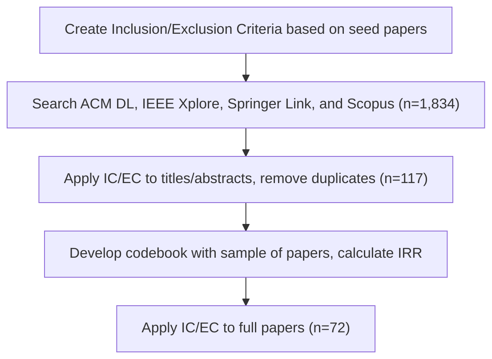

# GenAI-Powered Postsecondary Computer Science Education Tools
## A Systematic Literature Review

  

    
Owen Sizemore

    
  

  

    
Seth Bernstein

    
  

  

    
Audrey Ostrom

    
  

  

    
Thomas Rexin

    
  

  

    
Kristin Stephens-Martinez

    
  

---

# How do we regulate GenAI use in postsecondary CSEd?

- Ban it and AI-proof our classes
- Open the floodgates, encourage GenAI use from the introductory sequence onward
- Guide students on how to use GenAI responsibly

<!--
Consider replacing this with a spectrum, with option a on the left and option b on the right
-->
---

# What does this look like?
- Course interventions to learn new skills (prompting, evaluating GenAI output, etc.) 
- Assignments demonstrating the strengths/weaknesses of GenAI
- Student reflections to encourage thoughtful GenAI use
- Tools with guardrails that scaffold learning and mitigate irresponsible GenAI use

---

# Research Questions
1. **RQ1**: What approaches are currently used to build GenAI-powered postsecondary CSEd tools, and how are they motivated?
2. **RQ2**: What educational theories and framings inform the development of GenAI-powered postsecondary CSEd tools?
3. **RQ3**: What methods are used to empirically evaluate the effects of GenAI-powered postsecondary CSEd tools?

<!--Bold these-->
---

## Literature Review Methodology

---

## Codebook

  

    <h3>Problem Space</h3>
    
Why is the tool being built?

  

  

    <h3>Educational Framings</h3>
    
How does the tool support learning?

  

  

    <h3>Pedagogical Features</h3>
    
How does the tool support learning?

  

  

    <h3>Delivery Method</h3>
    
How do students access the tool?

  

  

    <h3>Evaluation Goals</h3>
    
What do the authors want to understand about the tool?

  

  

    <h3>Evaluation Methods</h3>
    
How are the tools empirically evaluated?

  

---

# Motivations for building tools (RQ1)

- 60%: Desire to provide personalized, context-aware support to students
- 57%: Concern that unrestricted GenAI use can lead to overreliance
- 38%: Lack of scalable help-seeking in CS classrooms

---

# Tool features and approaches (RQ1)

- 81%: Scaffolded feedback so the tool doesn’t give away answers
- 57%: Adapt feedback to students’ prior interactions
- 25%: Ground responses in curated learning material

- 63% of tools delivered via a standalone web app, others embedded in course platforms or packaged as IDE extensions

<!--
Some of these bullets need qualifying examples
Is there a way to make the (RQ1) text smaller?
-->
---

# Educational Framings (RQ2)

- Most frequent mentions: Scaffolding (63%), Cognitive Load Theory (36%), metacognition (36%), Self-regulated learning (23%)
  - High co-occurrence between all these
- No clear trend for when or how framings were used
  - Median of 3 framings mentioned
  - 13% of papers did not include any coded framings, but still built on prior work
  - Disproved our assumption that tools would be built without considering existing research
- Still need to understand connections between cited research and tool features

<!--
Potentially split this into 2 slides
-->
---

# Evaluation Goals (RQ3)

- 79%: Understand student perceptions
- 61%: Understand student usage patterns
- 33%: Measure impact on learning outcomes
  - Many examples: 
    - Post-intervention test performance
    - Changes between pre- and post-test scores
    - Measurements of affective state (self-efficacy, nervousness, etc.)

<!--
Include references?
-->
---

# Evaluation Methods (RQ3)

- Post-surveys and logging usage data both common and frequently done together (also relatively easy to perform)
- 38% of papers that included post-surveys also included pre-surveys
  - Less emphasis on measuring changes, just want to understand how students like the tool
- Multiple evaluation methods were common
  - 69% of papers used between 2 and 4 methods
  - 42 distinct combinations of evaluation methods
  - Just 2 papers had no evaluations at all

---

# Other Trends

- Model choice reasoning remains unclear
  - Most used OpenAI models, but future tools will need to consider institutional compliance and data privacy
- Tools predominantly targeted introductory CS students
- Control groups were seldom used in evaluations

---

# Recommendations

  

    <ph-question class="rec-icon" />
    <h3>Start with the problem, not the tool</h3>
  

  

    <ph-books class="rec-icon" />
    <h3>Build on what the field already knows</h3>
  

  

    <ph-binoculars class="rec-icon" />
    <h3>Investigate the gaps</h3>
  

  

    <ph-arrows-split class="rec-icon" />
    <h3>Consider that students have alternatives</h3>
  

---

# Start with the problem, not the tool

- Resist the urge to build a solution that doesn’t address a specific problem 
- Don't integrate GenAI tools into your course without a meaningful justification 
- Apply principles from learner-centered design, HCI, & needsfinding

---

# Build on what the field already knows

- Understand what other tools have gotten right and wrong already
- Meet the minimum standards for a quality custom tool (prompt engineering, filtering out bad responses, minimizing hallucinations, etc.)
- Make meaningful connections to prior research in CSEd, learning science, cognitive science, and other fields

---

# Investigate the gaps

- This SLR suggests a skew toward introductory programming
- Tools with lots of scaffolding might be great for a CS1/CS2 environment, but unclear how this would fare with other students
- Expand the scope of tools to include more students and more competencies (software engineering, system design, AI-assisted programming, etc.)

---

# Consider that students have alternatives

- "If you build it, they will come" doesn’t apply to a student with plenty of GenAI tools to choose from
- Students will always have access to commercial tools in unsupervised settings
- Make thoughtful design decisions to give students a good reason to use your tool
  - Use RAG/databases to leverage course content
  - Embed tools in existing course platforms
  - Make regular improvements in response to feedback

---
layout: two-cols-header
autoClicks: false
---

# Summary

::left::

- GenAI-powered postsecondary CSEd tools are one of many strategies to regulate GenAI use
- Tools integrate pedagogical features to promote learning and limit the pitfalls of commercial GenAI
- Tools are contextualized by a wide range of educational framings and many evaluation strategies
- Consider the problem at hand, prior research, and student alternatives when making the decision to develop a tool

::right::

  
GenAI-Powered Postsecondary Computer Science Education Tools: A Systematic Literature Review

  
QR code

  
owen.sizemore@duke.edu

